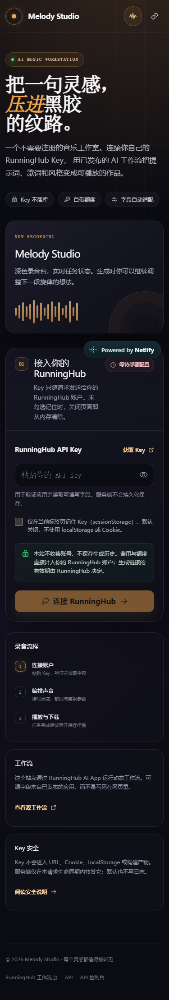
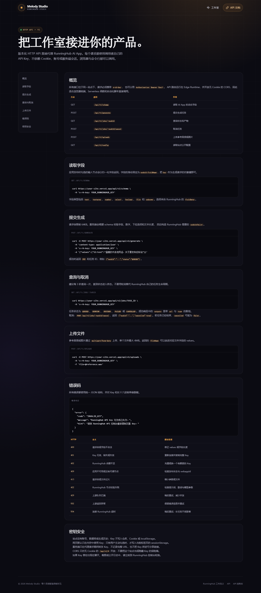

# Melody Studio

一个公开的多提供商音乐生成工作室。访客使用自己的 API Key 运行 RunningHub AI 应用、Replicate 模型、fal.ai 模型或 OpenAI 兼容音频接口，站点只做字段读取、任务代理与界面呈现。RunningHub 是默认提供商；所有提供商都由部署环境变量配置，访客不能提供任意上游地址。

## 预览

| 移动端工作室 | API 文档 |
| --- | --- |
|  |  |

## 当前状态

- 生产站点：https://melody-studio-rh-20261019.netlify.app
- AI App ID：`2112120926325272578`
- 已完成 Next.js 16 页面、动态字段表单、生成轮询、取消、音频播放、下载和 `/docs` API 文档。
- 已完成多提供商层：RunningHub（动态 schema）+ Replicate、fal.ai、OpenAI 兼容音频（固定中文参数集），以及提供商选择界面与按提供商的 Key 流程。
- 已完成 Node.js Runtime API、CORS、请求限制、字段校验、上游错误映射和 Key 脱敏。
- 已通过 TypeScript、ESLint、单元/模拟 API 测试和桌面/移动端 E2E 测试。
- 公网验证已通过：主页、文档、HTTPS、CORS、配置接口和无效 Key 的 401 响应。
- 真实生成试跑仍待有效 RunningHub Key；这里只缺一次真实短音频链路验证，不影响访客使用自己的 Key。
- `docs/workflow.reference.json` 目前是明确标记为不可用的占位文件，不是伪造的工作流导出。拿到有效 Key 后运行 `npm run fetch:workflow`。

## 环境要求

- Node.js 20.9+（当前工程使用 Node 24 验证）
- 一个 RunningHub 账户和有效 API Key
- 一个发布后的 RunningHub AI App，并从 `/ai-detail/<id>` 取得数字 `webappId`
- Vercel 账号（部署时）

## 本地启动

```powershell
Copy-Item .env.example .env.local
# 编辑 .env.local，填入 RUNNINGHUB_WEBAPP_ID
npm install
npm run dev
```

打开 `http://localhost:3000`。站点未配置 `RUNNINGHUB_WEBAPP_ID` 时会显示明确的部署配置提示；访客无需填写站点所有者的 Key。

## 环境变量

| 变量 | 必填 | 说明 |
| --- | --- | --- |
| `RUNNINGHUB_WEBAPP_ID` | RunningHub 必填 | 已发布 AI App 的数字 ID |
| `RUNNINGHUB_BASE_URL` | 否 | 默认 `https://www.runninghub.cn`，只允许 RunningHub 官方域名 |
| `REPLICATE_MODEL` | Replicate 必填 | `owner/name` 或 `owner/name:version` |
| `REPLICATE_INPUT_MAP` | 否 | JSON：逻辑字段→Replicate 入参字段 |
| `FAL_MODEL` | fal.ai 必填 | 如 `fal-ai/stable-audio` |
| `FAL_INPUT_MAP` | 否 | JSON 映射，同上 |
| `OPENAI_AUDIO_BASE_URL` | OpenAI 兼容必填 | 仅 origin，如 `https://api.openai.com` |
| `OPENAI_AUDIO_MODEL` | 否 | 默认 `gpt-4o-mini-tts` |
| `OPENAI_AUDIO_INPUT_MAP` | 否 | JSON 映射，同上 |
| `NEXT_PUBLIC_SITE_NAME` | 否 | 站点名称，默认 `Melody Studio` |
| `RH_ALLOW_LOCAL_MOCK` | 否 | 仅本地 mock 上游时设置为 `1`，不要用于生产 |

站点所有者的 Key 不是站点环境变量。Key 由每位访客在浏览器中输入，并通过 `x-rh-key` 请求头传给代理。只配置 RunningHub 时，界面与 v1 早期版本行为一致；配置多个提供商后，连接表单会出现服务选择卡片。

固定字段提供商统一使用逻辑键：`prompt`（音乐描述）、`lyrics`（歌词）、`style`（风格）、`duration`（秒，1–600）、`instrumental`（纯音乐），OpenAI 兼容另有 `voice`。OpenAI 兼容音频是同步接口，音频以 data URI 直接返回；Netlify 函数有时限，较长音频建议使用异步提供商。

## 发布 RunningHub AI App

1. 打开 [源工作流](https://www.runninghub.cn/workflow/2110715799911616513) 并确认它能正常运行。
2. 在工作流页选择“发布为 AI 应用”。
3. 勾选允许访客调整的输入节点，例如提示词、歌词、风格、时长和参考音频。
4. 设置应用名称、封面与说明并发布。
5. 从生成的 `/ai-detail/<id>` 页面复制纯数字 ID。
6. 把该 ID 设置为 `RUNNINGHUB_WEBAPP_ID` 并重新部署。

应用没有暴露节点时，`GET /api/v1/schema` 会返回 `NO_NODES`，页面会给出修复提示。

## 导出工作流参考 JSON

不要把 Key 写进仓库。推荐放在用户目录：

```powershell
New-Item -ItemType Directory -Force "$env:USERPROFILE\.config\runninghub" | Out-Null
notepad "$env:USERPROFILE\.config\runninghub\api_key.txt"
npm run fetch:workflow
```

也可以使用环境变量：

```powershell
$env:RUNNINGHUB_API_KEY = "YOUR_KEY"
npm run fetch:workflow
Remove-Item Env:RUNNINGHUB_API_KEY
```

脚本会把工作流结构写入 `docs/workflow.reference.json`，运行时不会读取该文件。网站运行时以 `apiCallDemo` 返回的已发布 AI App schema 为准。

## HTTP API

所有接口要求 `x-rh-key`。也可以使用 `Authorization: Bearer <key>`。未指定提供商时默认 RunningHub，可通过 `?provider=<id>`、`x-provider-id` 头或请求体 `providerId` 指定。

| 方法 | 路径 | 作用 |
| --- | --- | --- |
| `GET` | `/api/v1/config` | 公开配置、接口索引与已启用提供商列表 |
| `GET` | `/api/v1/schema` | 读取并归一化当前提供商的字段 |
| `POST` | `/api/v1/generate` | 提交生成任务，返回完整任务视图 |
| `GET` | `/api/v1/jobs/:taskId` | 查询状态与产物 |
| `POST` | `/api/v1/jobs/:taskId/cancel` | 取消任务 |
| `POST` | `/api/v1/uploads` | 上传 4MB 以内的参考音频或图片（仅支持的提供商） |

```bash
curl -X POST https://your-site.example/api/v1/generate \
  -H 'content-type: application/json' \
  -H 'x-rh-key: YOUR_RUNNINGHUB_KEY' \
  -d '{"values":{"12:text":"温暖的木吉他民谣，关于夏夜和旧车站"}}'
```

RunningHub 字段键使用 `nodeId:fieldName`；固定提供商使用 `prompt`/`lyrics`/`style`/`duration`/`instrumental`（OpenAI 兼容另有 `voice`）。具体键由 `/api/v1/schema` 返回，完整说明见站点 `/docs`。

## 测试与质量检查

```powershell
npm run typecheck
npm run lint
npm test
npm run build
npm run test:e2e
```

`test:e2e` 使用 Playwright 模拟提供商、生成任务和产物，不需要真实 Key。首次运行前可执行：

```powershell
npx playwright install chromium
```

真实试跑应在配置有效 Key 和已发布 App 后只执行一次短音频生成，确认提交、轮询、播放和下载整条链路。

## Netlify 部署

生产项目：`melody-studio-rh-20261019`  
项目 ID：`69b11357-5e06-4caa-9f75-f1afd2114a25`

```powershell
npx netlify-cli login
npx netlify-cli env:set RUNNINGHUB_WEBAPP_ID 2112120926325272578 --site melody-studio-rh-20261019 --force
npx netlify-cli deploy --build --prod --site 69b11357-5e06-4caa-9f75-f1afd2114a25
```

启用更多提供商时，用同样的 `env:set` 追加 `REPLICATE_MODEL`、`FAL_MODEL`、`OPENAI_AUDIO_BASE_URL` 等变量后重新部署即可；不配置则界面只显示 RunningHub。

`netlify.toml` 已配置 Next.js Runtime 5.16.2 和 Node.js 22 构建环境。API 路由使用默认 Node.js Runtime，因此不依赖已弃用的 Next.js Edge Runtime。

Netlify Credit Free 新项目默认是 Private。项目设置路径为：

`Project configuration` → `General` → `Visitor access` → `Project visibility`

生产环境的 Visibility 必须设为 `Public`，否则匿名访客会被重定向到 Netlify 登录页。

## 安全边界

- 不使用 Cookie、账号、数据库或服务端会话。
- 默认不持久化 Key；只有用户主动勾选时，才把 Key 放入当前标签页的 `sessionStorage`。
- 不写 `localStorage`，不把 Key 放进 URL、构建变量或可分享链接。
- 服务端错误和日志统一脱敏；CORS 只开放无 Cookie的 `/api/v1/*`。
- 提供商 Base URL 全部来自部署配置，访客无法让站点请求任意地址；Key 从不写入 URL、Cookie 或构建产物。
- 生成产物的存储与有效期由各提供商决定；v1 不提供长期音频托管。

## 项目结构

```text
app/                 Next.js 页面与 API 路由
components/studio.tsx 客户端工作室界面与轮询逻辑
lib/runninghub.ts    RunningHub 上游代理与错误映射
lib/fields.ts        字段解析、schema 归一化与参数构造
lib/providers/       提供商适配器与注册表（runninghub / replicate / fal / openai-audio）
lib/errors.ts        错误类型与 Key 脱敏
lib/site.ts          站点常量与按提供商的 Key 存储名
tests/               Vitest 与 Playwright 测试
docs/                工作流参考与额外说明
scripts/             工作流导出脚本
```